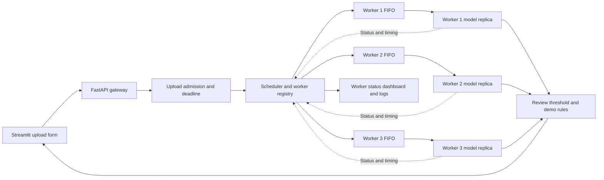

# Architecture

The gateway owns every waiting queue in memory. Admission reserves capacity
before reading a multipart upload. The scheduler selects a compatible worker,
and one dispatcher per worker sends requests in FIFO order. Each worker holds
a full copy of the trained model and runs one inference at a time.

The gateway applies the model's saved review threshold before looking up demo
guidance. Deadlines cover the original request, including any retry. Worker
status supplies the boot ID and last finished attempt so the gateway can
reconcile uncertain work. The gateway is a single process and a single point
of failure. [Scheduling and recovery details](demo.md)

Offline, the dataset audit builds checksummed train, validation, and test
manifests. Training selects the checkpoint and review threshold on validation
data, then exports weights, preprocessing, and label order. The held-out model
evaluation and serving benchmarks answer separate questions.
[Model instructions and results](model.md)
